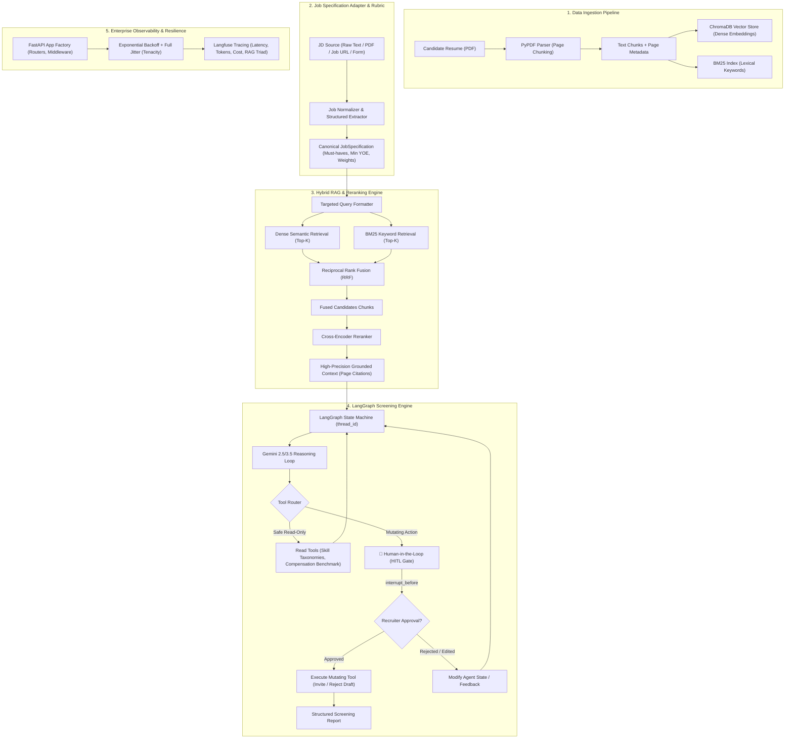
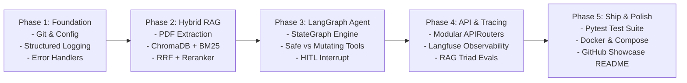

# 🏛️ Enterprise Candidate Intelligence & Screening Agent: Architecture & Roadmap

## 1. Executive Summary & Business Problem

### 1.1 The Industry Problem
In enterprise recruiting, talent acquisition teams process thousands of resumes per job opening:
* **The Manual Bottleneck:** Recruiters spend 30–45 seconds per resume, relying on superficial keyword matching.
* **The Semantic Blindspot:** Traditional Applicant Tracking Systems (ATS) miss qualified candidates who describe skills differently (e.g., *"orchestrated partitioned Kafka topic consumers for high-throughput stream ingestion"* vs. *"experienced in event-driven microservices"*).
* **The Naive GenAI Trap:** Naive RAG implementations hallucinate qualifications, lose context in multi-page resumes, suffer from high latency, and lack auditable page-level citations. Furthermore, fully autonomous agents risk legal liability if they unilaterally reject candidates or trigger unauthorized communications.

### 1.2 The Solution
The **Enterprise Candidate Intelligence & Screening Agent** is a production-ready, bounded AI system that:
1. **Ingests & Indexes Resumes** using **Hybrid Search** (Dense Vector + BM25 Sparse Search) fused via **Reciprocal Rank Fusion (RRF)** and filtered by a **Cross-Encoder Reranker**.
2. **Generates Grounded Evaluations** with strict page-level citations (`[Page X]`), computing a verifiable Match Score, Skills Gap Analysis, and Experience Fit against a target Job Description.
3. **Supports Polymorphic Job Requirements & Configurable Rubrics**: Recruiters can supply criteria in 3 flexible ways: (a) structured parameters (min years, must-have skills, weights), (b) raw text / uploaded JD PDF, or (c) a live Job URL. A parsing adapter normalizes all formats into a canonical `JobSpecification` schema with custom scoring weights.
4. **Orchestrates Decision Workflows** using **LangGraph**, separating safe read-only tools from mutating side-effect tools (e.g., triggering interview invitations or adverse rejection notices).
5. **Enforces Human-in-the-Loop (HITL) Governance** via state checkpointers (`interrupt_before`), requiring human recruiter approval before state mutation.
6. **Ensures Enterprise Reliability & Observability** via exponential backoff with jitter, structured JSON logging, and complete end-to-end tracing in **Langfuse** (tracking latency, cost, and RAG Triad scores).

---

## 2. End-to-End System Architecture



---

## 3. Key Architectural Decisions & Interview Defense

| Architectural Decision | Why We Chose It | Alternative Rejected | Interview Defense (The "Why") |
| :--- | :--- | :--- | :--- |
| **Hybrid Search (Dense + BM25 via RRF)** | Captures both conceptual similarity and exact keyword matches (certifications, tool versions, acronyms). | Pure Vector Search | Dense embeddings fail on exact acronyms (e.g., *"CKS"*, *"AWS SAP-C02"*, *"Java 21"*). BM25 guarantees exact keyword hits, while dense captures semantic context. RRF merges them without scale-mismatch issues. |
| **Cross-Encoder Reranker** | Computes joint attention across `(Query, Passage)` to eliminate noise chunks before passing to the LLM. | Bi-encoder only / Top-K raw vectors | Bi-encoders embed query and passage independently to keep search fast ($O(1)$ vector lookup). However, independent embeddings miss subtle semantic nuance. Reranking top 15 results down to top 4 eliminates context window bloat and drops LLM input token costs by ~60%. |
| **LangGraph ReAct StateGraph** | Explicit state persistence with checkpointers, cycle breakers, and human-in-the-loop interruption. | Autonomous loops (AutoGPT / CrewAI multi-agent) | Pure autonomous agents easily fall into non-deterministic infinite loops. LangGraph allows explicit graph topology, strict recursion depth caps (`recursion_limit=10`), and state checkpointing via `thread_id`. |
| **Human-in-the-Loop (HITL) Gate** | Requires explicit recruiter sign-off before executing mutating actions (invites, rejections). | Fully automated tool execution | In HR tech and high-stakes enterprise systems, automated communication without human oversight introduces major legal and compliance risks. HITL with `interrupt_before` provides non-repudiation. |
| **Exponential Backoff with Full Jitter** | Mitigates rate limits (HTTP 429) and prevents the "thundering herd" problem on LLM API spikes. | Fixed retry delay or naive sleep | Fixed retries cause synchronized retries across concurrent requests. Full jitter spreads requests across a randomized time window: $t = \text{random}(0, \min(M, B \cdot 2^i))$. |
| **Pydantic Settings & Structured JSON Logging** | Fail-fast initialization at startup and machine-readable logs for CloudWatch / Datadog. | `os.environ.get()` and `print()` | Raw `os.environ` fails at runtime inside deep request handlers. `pydantic-settings` validates environment variables on application startup. JSON logs allow structured querying by `trace_id` and `candidate_id`. |

---

## 4. Phased Implementation Roadmap



### Phase 1: Enterprise Repository Foundation & Core Hygiene (Wave 3.1)
* Git initialization, professional `.gitignore`, `.env.example`.
* `app/core/config.py`: Fail-fast Pydantic `BaseSettings` schema.
* `app/core/logger.py`: Production structured logger outputting JSON with contextual tags.
* `app/core/exceptions.py`: Custom domain exceptions mapped to clean HTTP status codes (400, 404, 429, 502, 503).

### Phase 2: Production Hybrid RAG & Ingestion Engine (Wave 2.1 & 3.1)
* `app/services/rag/ingestion.py`: Robust PDF resume parser extracting text with strict page number metadata (`page: 1`).
* `app/services/rag/retrievers.py`: Dense vector store (`ChromaDB`) + Sparse BM25 index.
* `app/services/rag/hybrid.py`: Reciprocal Rank Fusion (RRF) algorithm to combine rank scores.
* `app/services/rag/reranker.py`: Cross-Encoder reranking pass to output the top 3-5 definitive passages with exact page citations.

### Phase 3: LangGraph Agentic Screening Engine (Wave 2.3 - 2.5)
* `app/models/agent_state.py`: Typed Pydantic agent state holding `candidate_id`, `job_description`, `retrieved_evidence`, `match_score`, `gaps`, `next_action`, and `approval_status`.
* `app/services/agent/tools.py`:
  * *Read-only tools:* `benchmark_salary()`, `check_skill_taxonomy()`.
  * *Mutating tools:* `draft_interview_invite()`, `draft_rejection_notice()`.
* `app/services/agent/graph.py`: StateGraph definition with `interrupt_before=["draft_interview_invite", "draft_rejection_notice"]` and `MemorySaver` / SQLite checkpointer.

### Phase 4: Modular API Layer & Langfuse Observability (Wave 2.2 & 3.1)
* `app/routers/candidates.py`: Upload PDF resume, trigger ingestion, retrieve candidate metadata.
* `app/routers/screening.py`: Initiate screening against a Job Description, return grounded evaluation with page citations.
* `app/routers/actions.py`: Recruiter review endpoint (`/approve`, `/reject`) to resume LangGraph state from checkpoint.
* Observability: Integration with Langfuse via callback handlers, logging LLM tokens, latency, cost, and RAG Triad metrics (Faithfulness & Answer Relevancy).

### Phase 5: Testing, Containerization & GitHub Packaging (Wave 3.2 - 3.5)
* `tests/`: Automated unit and integration tests with `pytest` and `httpx` (mocking external LLM calls to test resilience without API cost).
* `Dockerfile`: Multi-stage, non-root lightweight Docker container.
* `docker-compose.yml`: Single-command spin-up orchestrating FastAPI and persistent vector storage.
* `README.md`: High-impact GitHub repository presentation featuring architecture diagrams, API specs, and interview talking points.

---

## 5. How This Anchors Your 3.5 YOE Story in Interviews

```
"In my background developing high-throughput distributed microservices, I saw how many GenAI projects 
fail in production due to lack of software engineering discipline—unhandled rate limits, context bloat, 
unbounded agent loops, and zero auditability.

In the Enterprise Candidate Intelligence Agent, I applied distributed systems patterns to LLM systems:
1. Implemented Hybrid Search (BM25 + Dense Vectors fused via RRF) and Cross-Encoder reranking, cutting 
   LLM input tokens by 60% while eliminating keyword blindspots.
2. Built the screening engine as a deterministic LangGraph state machine with recursion circuit breakers 
   and Human-in-the-Loop checkpointers for any action with side effects.
3. Hardened the service with exponential backoff with full jitter and end-to-end tracing in Langfuse to 
   track RAG Triad scores, latency, and cost per screening run."
```
